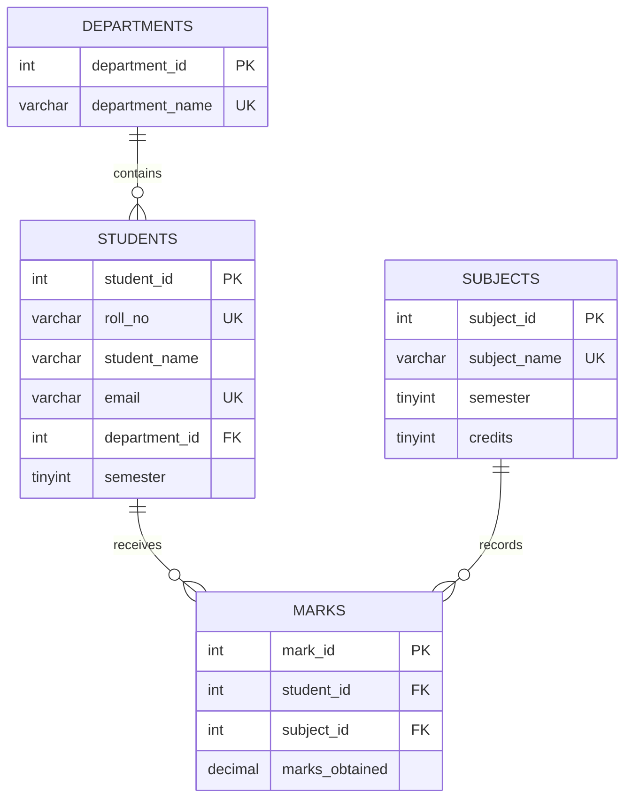

Student Performance Analytics System
A student performance analysis project built with MySQL and Python. It stores student academic data in a relational database, analyzes marks across subjects and departments, identifies top-performing students, and generates reports and visualizations.
Project Overview
The project uses sample academic data for 30 students, 4 departments, 6 subjects, and 180 student-subject marks records. The SQL script demonstrates relational database design and SQL-based analysis. The Python notebook cleans and combines CSV exports, calculates student-level performance metrics, creates charts, ranks students, and exports a report.
Objectives
- Organize student, department, subject, and marks data in a relational database.
- Apply database constraints to protect data integrity.
- Use SQL joins, aggregate functions, common table expressions, and window functions to analyze academic results.
- Use Python and Pandas to clean data and prepare student reports.
- Compare performance across subjects and departments.
- Visualize grade and marks distributions and export results to CSV.
Technology Stack
Tool or Library	Purpose
MySQL 8.0.16+	Database schema, constraints, SQL functions, and queries
Python 3	Data processing and analysis
Pandas	Data cleaning, merging, aggregation, and report generation
Matplotlib	Charts and plots
Seaborn	Statistical visualizations
Jupyter Notebook / Google Colab	Running the Python analysis notebook
MySQL Workbench	Running and inspecting the SQL script

Database Design
The database is named student_analytics and contains four tables.
Table	Description	Important relationships
departments	Department ID and department name	Referenced by students
students	Student ID, roll number, name, email, department, and semester	Each student belongs to a department
subjects	Subject name, semester, and credit value	Referenced by marks
marks	Marks obtained by a student in a subject	References students and subjects

Key Features
SQL Analysis
- Creates and populates the four database tables.
- Uses primary keys, foreign keys, unique constraints, NOT NULL, CHECK, and default values.
- Joins student, department, subject, and marks data into a detailed academic record.
- Calculates subject-wise average, minimum, and maximum marks.
- Finds the highest-performing student or students in each department, including ties.
- Identifies students who scored below 40 in at least one subject.
- Calculates department-level average marks.
- Defines SQL functions to calculate grades, student percentages, and pass/fail results.
- Includes commented-out examples for testing database constraints.
Python Analysis
- Loads department, student, subject, and marks data from CSV files.
- Converts marks to numeric values, removes duplicate student-subject records, and fills missing marks with the mean for the relevant subject.
- Merges the datasets and creates a student-wise report.
- Calculates total marks, average percentage, grade, result, and rank.
- Calculates subject-level averages, minimums, maximums, and pass rates.
- Compares average student percentages across departments.
- Displays the top 10 students.
- Creates charts for subject averages, grade distribution, marks distribution, and percentage distribution by department.
- Exports the student report to student_report.csv.
Example Results
The following values are from the output saved in the included notebook. They describe the sample dataset, not a live or real institutional database.
Subject-wise analysis
Subject	Average marks	Lowest marks	Highest marks	Pass rate
Python Programming	74.43	32	100	96.67%
Database Systems	68.00	35	100	96.67%
Statistics	71.63	30	100	96.67%
Data Structures	69.80	32	95	96.67%
Machine Learning	72.60	33	97	96.67%
Data Visualization	75.37	38	100	96.67%

Department-wise average percentage
Department	Average percentage
Computer Science	71.02%
Data Science	70.33%
Information Technology	71.36%
Electronics	75.55%

Sample topper output
Rank	Student	Average percentage	Grade	Result
1	Yash Gupta	83.17%	A	Pass
2	Sakshi Jha	82.50%	A	Pass
2	Ira Singh	82.50%	A	Pass
4	Nikhil Das	79.33%	A	Pass
5	Vikram Das	77.67%	A	Pass

The notebook uses the minimum ranking method, so students with the same percentage can share a rank.
Project Files
File	Purpose
mySQL(2).sql	Creates the database and tables, inserts sample data, defines SQL functions, and runs example queries.
Untitled0(3).ipynb	Performs data cleaning, analysis, visualization, ranking, and CSV export in Python.

For a cleaner GitHub repository, consider renaming these files to student_performance.sql and student_performance_analysis.ipynb before uploading.
How to Run the Project
1. Run the SQL script
1. Install MySQL 8.0.16 or later and open MySQL Workbench.
2. Open mySQL(2).sql and review the script before executing it.
3. Important: the script begins with DROP DATABASE IF EXISTS student_analytics;, which deletes an existing database with that name before recreating it.
4. At the end of the script, comment out or remove DROP DATABASE student_analytics; if you want to keep the database after the queries finish. Otherwise, the database will be deleted at the end of execution.
5. Execute the script and review the result sets returned by the analysis queries.
2. Prepare CSV files for Python
The notebook reads four separate CSV files. These files are not included in the provided project files, so you must export them from the created database or supply equivalent files with the expected columns:
- departments.csv
- students.csv
- subjects.csv
- marks.csv
Export each corresponding table from MySQL Workbench as CSV. If using Google Colab, upload the CSV files to /content. If using Jupyter locally, either place the files in the notebook's working directory and update the paths in the notebook, or change the code to point to their actual locations.

Expected columns include:
- departments.csv: department_id, department_name
- students.csv: student_id, roll_no, student_name, email, department_id, semester
- subjects.csv: subject_id, subject_name, semester, credits
- marks.csv: mark_id, student_id, subject_id, marks_obtained
3. Install Python dependencies
Run the following command in your Python environment if the packages are not already installed:
pip install pandas matplotlib seaborn jupyter
4. Run the notebook
1. Open Untitled0(3).ipynb in Jupyter Notebook or upload it to Google Colab.
2. Make sure the four CSV files are available at the paths used in the first cell.
3. Run the notebook cells in order.
4. Review the student report, subject and department summaries, charts, and top 10 list.
Generated Outputs
The notebook exports the following files to /content when run in Google Colab. If you run it elsewhere, change the output paths to a directory on your system.
- student_report.csv — student-level report with subject marks, total marks, percentage, grade, result, and rank.
- average_marks_by_subject.png — subject-wise average marks chart.
- grade_distribution.png — grade distribution pie chart.
- marks_histogram.png — distribution of marks obtained.
- percentage_by_department_boxplot.png — student percentage distribution by department.
Important Notes
- Grade thresholds differ between SQL and Python. The SQL function uses A+ at 90, A at 80, B at 70, C at 60, D at 50, E at 40, and F below 40. The Python notebook uses A+ at 85, A at 75, B at 65, C at 50, D at 40, and F below 40. As a result, a student may receive different grades in the two implementations. Align these rules if consistent grades are required.
- The pass/fail rule in both implementations is based on whether any subject mark is below 40, but the SQL function returns N/A if no marks exist for a student.
- The Python notebook fills missing marks with that subject's average. This is a project-level preprocessing choice and may affect calculated results if the source data contains missing values.
- The SQL script includes commented constraint tests. Uncomment and run them individually only when deliberately testing constraint violations.
Skills Demonstrated
SQL database design, relational modeling, data integrity, joins, aggregate queries, common table expressions, window functions, user-defined functions, Python data cleaning, Pandas analysis, data visualization, ranking, and report export.
